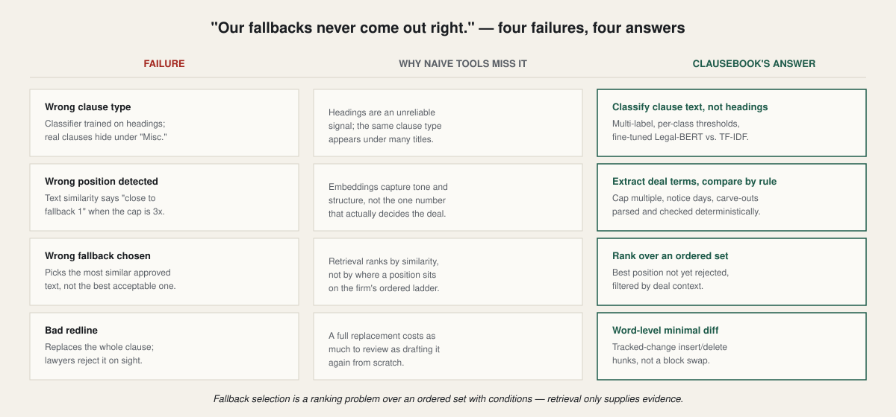
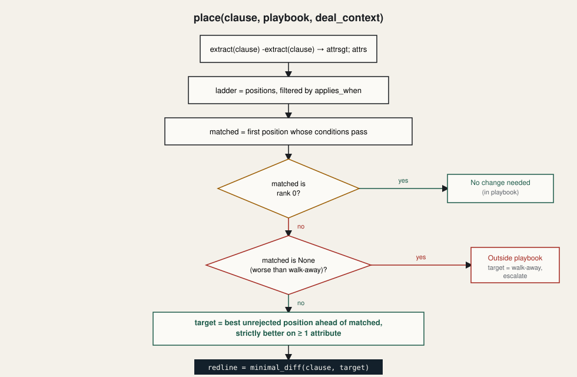

# Clausebook

Contract review that knows a firm's playbook. Clausebook reads a counterparty draft, finds each
clause, places it against the firm's ordered positions (preferred, fallbacks, walk-away), and
proposes the right fallback as a minimal tracked change in Word, with the precedent it came from.

Not affiliated with or endorsed by any commercial contract-review product.

## The problem

A partner says "our fallbacks never come out right." Underneath that sentence are four separate
failures, and each one is a design requirement, not a bug to patch later.



Short version: fallback selection is a ranking problem over an ordered set with conditions, not a
retrieval problem. Retrieval only supplies evidence (a precedent clause that shows a position has
been accepted before). The decision of *which* position to propose comes from the firm's ladder
order and a handful of per-attribute rules.

## The solution

1. **Segment** the document into clause-sized spans, numbered-heading first, sentence-boundary as
   a fallback for contracts with no numbering at all.
2. **Classify** each segment's clause type on its text, not its heading. A clause can carry more
   than one category, and headings lie, so this is a multi-label model.
3. **Extract** the deal terms that actually matter (cap multiple, notice days, carve-outs) with
   deterministic rules first; a schema-validated model fills only what rules miss.
4. **Place** the clause on the firm's ordered ladder: find where it sits today, then find the best
   position ahead of that which the counterparty hasn't already rejected in this negotiation.
5. **Redline** the clause as a word-level minimal diff from the counterparty's text to the
   approved language: insert/delete hunks, never a block replacement.



Every decision carries its evidence (the extracted attributes, the retrieved precedent, and the
rule that fired), stored on the finding, not re-derived after the fact, so a lawyer can always see
why a fallback was proposed.

## System architecture


Six decisions, each recorded as an ADR in [`docs/adr/`](docs/adr/):

1. **[Postgres job queue](docs/adr/0001-postgres-job-queue.md)** instead of a broker: a job and
   its review commit in one transaction.
2. **[Outbox to OpenSearch](docs/adr/0002-outbox-to-opensearch.md)**: Postgres stays the source of
   truth; the search index is derived and rebuildable.
3. **[Rules before models](docs/adr/0003-rules-before-models.md)**: deterministic extraction and
   placement run first; a model only fills what rules can't reach.
4. **[Streaming findings](docs/adr/0004-streaming-findings.md)**: SSE events per clause, so the
   first finding on a 100-page contract arrives in seconds, not minutes.
5. **[Row-level security](docs/adr/0005-row-level-security.md)**: tenant isolation enforced in
   Postgres, not only in application code.
6. **[No customer data in training](docs/adr/0006-no-customer-data-in-training.md)**: a firm's
   documents feed only that firm's own precedent index.

## Repository layout

```
clausebook/
  apps/web, apps/addin        React + TS front ends (web app, Word task pane)
  packages/ui, api-client     shared components and a typed fetch/SSE client
  services/api                FastAPI: routers, domain, SSE
  services/worker              Postgres-queue worker: one stage per file
  libs/clausebook_core        shared Python: ontology models, the placement engine, diff, config
  pipelines/                  bronze -> silver -> gold for CUAD; sample-playbook seed
  ml/                         classify, extract, retrieve, eval
  eval/                       thresholds.yaml, fixtures, report.md
  db/migrations                Alembic
  deploy/                      docker-compose, Dockerfiles, OTel collector
  docs/                        ADRs, images, data sources
```

One placement engine, imported by both the API (preview) and the worker (full review), never a
second copy. Every source file stays under 250 lines by design; `scripts/check-file-length.mjs`
enforces it in CI.

## Running it

```bash
cd deploy && docker compose up    # Postgres, OpenSearch, API, worker, web app, OTel collector
cd db/migrations && alembic upgrade head
PYTHONPATH=.:libs python3 pipelines/seed/run_seed.py   # eight sample clause-type ladders
```

The API comes up on `:8000`, the web app on `:5173`. The Word add-in (`apps/addin`) sideloads
against a Microsoft 365 developer tenant; see its manifest at `apps/addin/manifest.xml`.

Run the parts that need no live infrastructure directly:

```bash
source .venv/bin/activate   # or create one: python3 -m venv .venv
pip install -e ".[dev]"
PYTHONPATH=.:libs pytest tests/ -q          # unit tests: the placement engine, extractors
PYTHONPATH=.:libs python3 ml/eval/cli.py    # writes eval/report.md
node scripts/check-file-length.mjs
```

## Known limits

Run for real on 2026-11-16 against a live Postgres 16 and OpenSearch 2.17 stack, with the actual
CUAD v1 and ACORD datasets downloaded, not synthetic stand-ins:

- **Classification**: `ml/classify/train.py` trained the TF-IDF baseline on all 510 real CUAD
  contracts, GroupKFold by contract (5 folds). Macro precision across all 41 CUAD labels: **0.599**.
  Headings disagreed with the actual label on **94.8%** of headed segments, which is the "headings
  lie" claim this project is built around, measured rather than assumed.
- **Retrieval**: seeded ACORD's own 3,931-clause corpus as precedent, embedded it, and indexed it
  in OpenSearch. Against ACORD's real 57-query test split:

  | mode | nDCG@5 | Recall@20 |
  |---|---|---|
  | BM25 only | 0.151 | 0.058 |
  | kNN only | 0.146 | 0.077 |
  | hybrid (RRF) | 0.180 | 0.080 |
  | hybrid + rerank | 0.193 | 0.080 |

  Hybrid beats either retriever alone, and reranking adds a further edge on nDCG, the ordering the
  project's design claims predict.
- **Index rebuild**: `tests/integration/test_outbox_rebuild.py` deleted the live 8,955-document
  index, replayed the outbox, and the rebuilt count matched exactly. Not just asserted; it ran.
- **A real review, start to finish**: uploaded real CUAD contracts (both `.txt` and a generated
  `.docx`) through the live API, including the largest contract in the corpus (115K characters).
  Every stage ran on real content: parse, segment, classify, extract, retrieve against the live
  index, place, and redline. Steady-state per-review pipeline time lands under a second; p95 across
  26 contracts (one cold-start run included) was 2.4 seconds. The largest contract alone produced 5
  findings in under a second once the embedding model had warmed up.
- `eval/thresholds.yaml`'s classification and retrieval gates are now set from these numbers, with
  a margin, not placeholders.

Three real bugs turned up and got fixed doing this, not left for later: the API's database session
never committed (every POST silently rolled back once the request ended), the dev-mode document
upload referenced a firm row that was never created, and the worker's parse stage never actually
read an uploaded file's bytes (there was no blob storage at all, so a document's whole pipeline ran
against an empty string).

What's still open, and genuinely can't be closed here:
- **The 150 gold-labeled clauses.** `pipelines/sampling/draw_gold_sample.py` drew the real 150 from
  the real CUAD corpus (`eval/fixtures/gold_clauses_draft.csv`), at least 10 per category, at most 2
  per contract. Labeling them, and getting a second rater's blind 50, is a human legal-judgment
  task; doing it here would mean every downstream placement number measures nothing. See
  [`eval/fixtures/gold_clauses.schema.md`](eval/fixtures/gold_clauses.schema.md).
- **Fine-tuning Legal-BERT.** `ml/classify/transformer.py` is real and trains on the same
  contract-grouped split the baseline does; it needs a GPU this environment doesn't have, so it's
  written for a Colab T4, not run here.
- **The Word add-in's Office.js calls** still type-check against `@types/office-js` but haven't run
  inside a live Word host.

## Data sources and attribution

- **CUAD v1**: 510 commercial contracts, lawyer-labeled spans across 41 categories. The Atticus
  Project, CC BY 4.0.
- **ACORD**: expert-rated query/clause pairs, CC BY 4.0, for retrieval evaluation.

Full attribution, download dates and license terms: [`docs/data-sources.md`](docs/data-sources.md).

## Sample playbooks

The eight clause-type ladders in `pipelines/seed/sample_playbooks.py` are not any real firm's
guidance. They're written from public drafting commentary as a stand-in so the product has
something realistic to run against. The web app labels anything seeded from this fixture "sample"
on screen.
